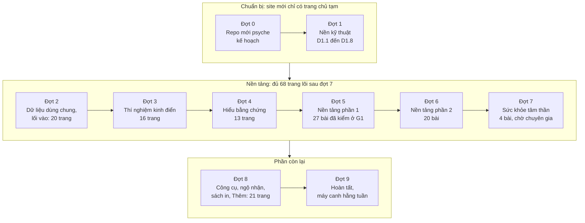
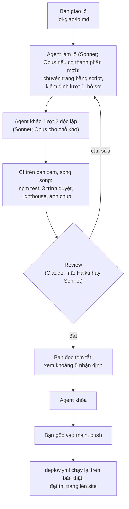
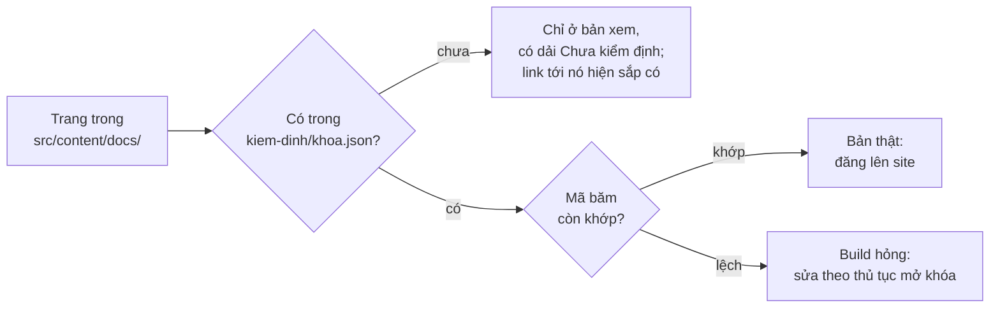
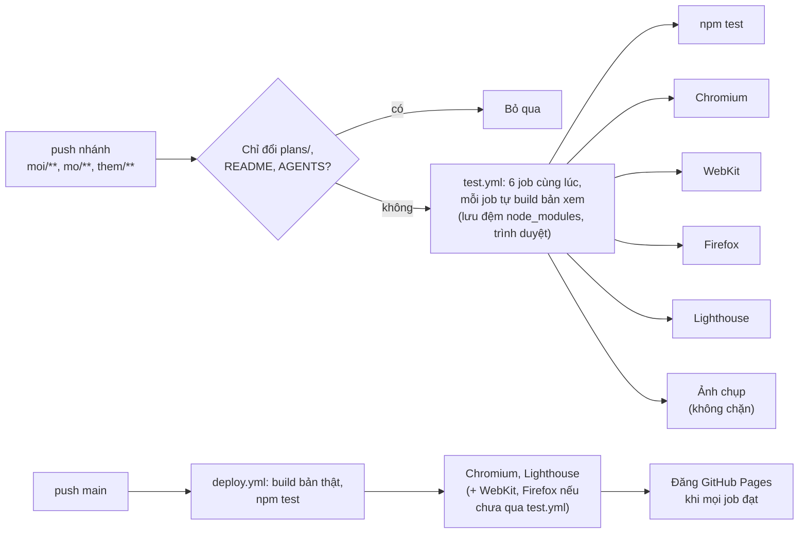
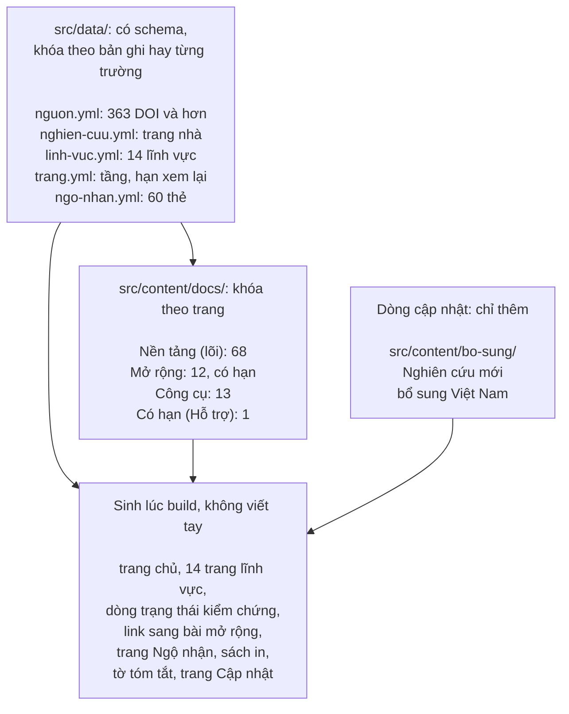
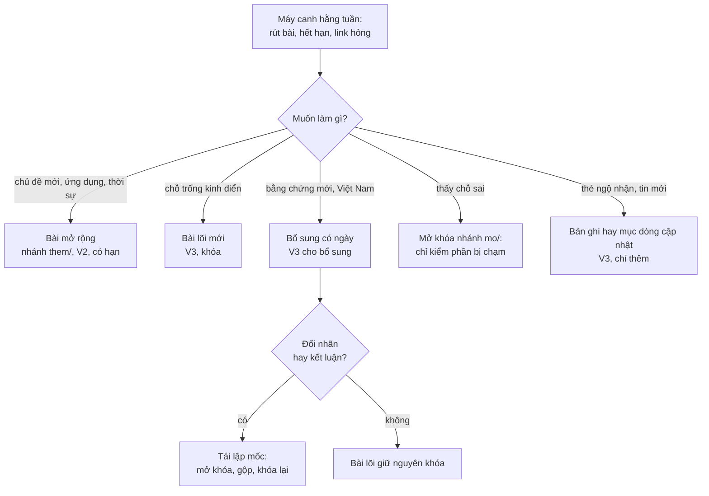

# Sơ đồ kế hoạch làm lại

Bản vẽ để nắm nhanh kế hoạch. Chữ trong `README.md` là chuẩn: sơ đồ khác chữ thì sửa sơ đồ. GitHub tự vẽ các khối `mermaid` dưới đây; sửa chúng như sửa chữ.

## 1. Mười đợt, làm lần lượt

Từ đợt 2, mỗi lô gộp vào `main` là trang của lô lên https://mtuann.github.io/psyche/. Site cũ ở `/psyche-zero/` chạy nguyên suốt thời gian này. Tổng 106 trang cũ và 15 trang mới, 18 lô nội dung.

## 2. Một lô đi qua những bước nào, model nào

## 3. Trang nào lên site

## 4. CI chạy song song

Thời gian chờ bằng job lâu nhất (khoảng 3–4 phút), không phải tổng các job.

## 5. Lớp dữ liệu, tầng và phần sinh lúc build

Thêm một bài mở rộng, một bổ sung hay một thẻ chỉ thêm file và hồ sơ của nó; trang lõi đã khóa không đổi, danh sách và link tự cập nhật lúc build (`../ben-vung/them-noi-dung.md`).

## 6. Sau khi làm lại: thêm hay sửa nội dung

